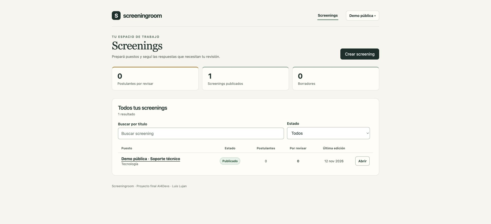

# Acceso público de revisión — 12/11/2026

[README](../readme.md#04-url-de-la-aplicación) · [Guía del revisor](revision-final.md).

Luis informó que Typeform no ofrecía un campo para compartir la contraseña y pidió publicar el acceso en el README. Eligió crear una cuenta de demo pública separada de la utilizada para las pruebas con su correo real.

| Campo | Valor |
| --- | --- |
| Aplicación | https://screeningroom-ll-demo.onrender.com |
| Usuario de demo | `demo@example.test` |
| Contraseña deliberadamente pública | `ScreeningroomDemo2026` |
| Nombre visible | Demo pública |

## Alta y alcance

La cuenta se aprovisionó en la colección `users` de `screeningroom_demo_public`, mediante el explorador de datos de la sesión Atlas de Luis, tras iniciar sesión personalmente. Se generó Argon2id con la misma función del backend y se validó el documento contra `UserSchema` antes del alta. No se leyó la contraseña de la cuenta anterior ni las claves de los servicios. No se modificaron acceso de red, permisos de Atlas, variables de Render, Brevo ni código de la aplicación.

Es un recruiter normal: puede crear sus propios screenings, invitar, leer informes y decidir. Sus datos pertenecen a un usuario distinto de `revisor@example.test`; no es una cuenta de administración de infraestructura. La creación fue operativa y explícita: `deploy/seed-demo.mjs` continúa aprovisionando la cuenta privada anterior, no recrea automáticamente esta cuenta pública si se borra la base. Los reinicios conservan los usuarios en Atlas. Para reconstruirla se puede usar el comando de [aprovisionamiento de recruiters](acceso.md#provisioning-administrativo-posterior) con este email/nombre y la contraseña pública, conectado exclusivamente a la base de demo.

## Verificación pública

1. La contraseña preparada se verificó con la función del backend y el documento cumplió el esquema antes de insertarlo.
2. El ingreso real por HTTPS como `demo@example.test` abrió **Demo pública**, con cero screenings y sin los registros del usuario anterior.
3. Abrir el identificador del SC privado usado en la verificación previa devolvió **No pudimos abrir el screening**, sin mostrar sus datos.
4. Se creó **Demo pública · Soporte técnico**, con una pregunta Sí/No requerida, puntuable, peso 3, Sí = 100, No = 0, excluyente cumplido por Sí y umbral 70. Se publicó y la recarga conservó **Publicado · v1 activa**.
5. El ejemplo se dejó publicado y sin postulantes. No se enviaron nuevos correos reales ni se copiaron invitaciones, respuestas o datos de la cuenta anterior.

## Uso compartido

Los datos creados con esta cuenta son visibles y modificables por cualquiera que use sus credenciales. Utilizar nombres y respuestas ficticios; para correo real, una dirección propia/autorizada de pruebas que se acepte compartir, pues también aparece en la lista de invitados. Se mantienen los límites existentes de 50 intentos externos por día UTC y por invitación/IP. No usar el acceso público para postulantes reales.

Las credenciales anteriores de la app y del buzón Mailpit siguen privadas. `example.test` se entrega a ese buzón, no a una casilla real; el recorrido público recomendado usa correo propio de pruebas. La clave publicada no da acceso a Atlas, Render, Brevo ni Mailpit. El registro de IA conserva las decisiones anteriores de acceso privado como historial y explica este cambio posterior.
