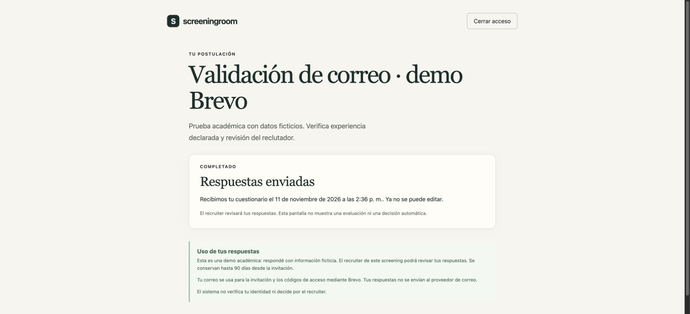
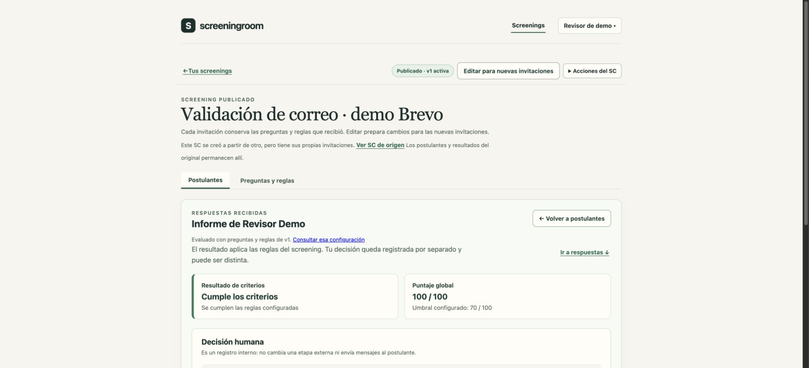

# Correo real para la revisión académica

Luis aprobó Brevo para que otra persona reciba la invitación y los códigos en su correo, sin comprar un dominio. **Activado y verificado en público el 11/11/2026**, sobre el despliegue `d1c7e0a`. La recepción inicial y el funcionamiento del enlace fueron confirmados por Luis; también se comprobaron códigos reales, reanudación, envío e informe. Mailpit permanece para direcciones ficticias y pruebas automáticas.

## Configuración privada en Render

La aplicación usa la [API HTTPS de Brevo](https://developers.brevo.com/reference/send-transac-email); Render Free bloquea los puertos SMTP habituales. No se agregan librerías ni se guardan claves en Git.

| Variable | Valor |
| --- | --- |
| `MAIL_PROVIDER` | `brevo` |
| `BREVO_API_KEY` | Clave de API de Brevo, no la clave SMTP |
| `MAIL_FROM_EMAIL` | Dirección del remitente verificado de Brevo |

Mantener `MONGODB_URI`, `SESSION_SECRET`, `DEMO_RECRUITER_PASSWORD` y `DEMO_MAIL_PASSWORD` existentes. No regenerar contraseñas ni secreto de sesión. Mailpit sigue disponible para las direcciones ficticias y las invitaciones anteriores.

En Brevo:

1. Completar la verificación de teléfono que solicita la cuenta y cualquier revisión de activación del correo transaccional.
2. Confirmar un remitente con nombre **Screeningroom** y una dirección propia. En la inspección del 11/11 ya figuraba verificado. Sin dominio propio, Brevo puede reemplazar la dirección visible por una de su infraestructura; no se garantiza llegada a bandeja principal. [Remitentes y sustitución](https://help.brevo.com/hc/en-us/articles/14925263522578-Comply-with-Gmail-Yahoo-and-Microsoft-s-requirements-for-email-senders).
3. En **Configuración → SMTP y API → Claves API**, crear una clave para esta demo. Luis debe introducirla directamente en Render y conservarla de forma privada; no se copia al chat, código, documentación ni capturas.
4. En Render, guardar las tres variables y desplegar el código actualizado de `feature/entrega-final-demo-LL`. Verificar `/api/health/ready` y el recorrido siguiente antes de presentar correo real como disponible.

El plan gratuito de Brevo ofrece 300 envíos diarios. La aplicación limita su propio uso a **50 intentos externos por día UTC**, incluyendo invitaciones y códigos; el contador persiste en MongoDB y no se reinicia con el servicio. Los límites por invitación y por IP permanecen. [Límites del plan](https://help.brevo.com/hc/en-us/articles/208589409-About-Brevo-s-pricing-plans).

## Comportamiento del producto

- Sin `MAIL_PROVIDER`, se usa Mailpit y solo se admiten direcciones `example.test`. Configuración desconocida o Brevo sin clave/remitente impide el arranque.
- Con Brevo, se pueden invitar direcciones personales de personas que hayan aceptado probar la demo. Los mensajes reales no se copian a Mailpit. `example.test` siempre permanece en Mailpit, también con Brevo activo.
- La confirmación de envío significa que la API aceptó el mensaje; no acredita recepción ni lectura. No se implementan webhooks de entrega o rebote.
- Si Brevo rechaza expresamente una invitación, se informa el error, se conservan los campos del formulario y se elimina el registro intacto para permitir reintentar.
- Si se pierde la respuesta, hay timeout, 5xx o recibo ilegible, se conserva la invitación con estado de correo **sin confirmar**, visible al recargar. No se reintenta automáticamente. El recruiter puede copiar el enlace; el candidato verifica el correo con un código. El fallo de guardar el recibo tras una aceptación tampoco invalida un enlace ya enviado.
- Las nuevas ayudas indican bandeja de entrada/spam o buzón de prueba según corresponda. Las invitaciones anteriores conservan preguntas, reglas, respuestas y vigencia.

## Datos y alcance

Esta es una revisión académica voluntaria: usar solo un correo propio o autorizado y mantener nombres/respuestas ficticios. Brevo recibe destinatario, remitente y contenido de la invitación o código. No recibe respuestas, informes ni decisiones y no se crean contactos o campañas de marketing.

La interfaz recuerda el uso del correo y la conservación de hasta 90 días desde la invitación. T-09 continúa parcial: no se presenta esta integración como borrado anticipado completo, gestión de consentimiento de un servicio de selección ni preparación para postulantes reales. Los mensajes también quedan sujetos al almacenamiento y configuración de la cuenta Brevo.

## Prueba real del 11/11/2026

Luis introdujo personalmente los secretos en Render y autorizó enviar la prueba al mismo correo del remitente verificado. Se desplegó `d1c7e0a` correctamente, sin cambiar plan ni credenciales anteriores. La clave se preparó con acceso restringido a Emails transaccionales y vencimiento de tres meses; no se leyó su valor.

1. Se copió el SC ficticio anterior a **Validación de correo · demo Brevo**, se revisó y publicó v1, manteniendo independiente el informe del original.
2. Se envió una invitación a la dirección autorizada, con nombre ficticio **Revisor Demo**. Brevo registró **Enviado/Entregado**. Luis confirmó que recibió el correo y abrió el enlace correctamente.
3. Se abrió el enlace compartible en el navegador de pruebas y se solicitó un código. Brevo lo marcó entregado; la verificación abrió el cuestionario y la ayuda indicó bandeja/spam.
4. Se respondió **Sí**, se guardó y se cerró acceso. Otro código real permitió recuperar la respuesta guardada. No se publicaron códigos ni enlaces de acceso en la evidencia.
5. Se revisó y envió la respuesta. El recibo permaneció tras recargar. El informe del recruiter mostró **100/100**, umbral 70 y excluyente cumplido, con decisión humana todavía pendiente.

El SC de esta prueba quedó publicado para revisión. La prueba anterior de Mailpit conserva su estado cerrado y la decisión independiente. La verificación del proveedor se limitó a los mensajes autorizados; una lectura que podía mostrar enlaces privados fue bloqueada y se sustituyó por consultas de estado y extracción privada del código sin imprimirlo.

## Evidencia automatizada

Se incorporaron siete pruebas de correo: configuración, payload y escape HTML, código y errores seguros, timeout/5xx/recibo inválido, Mailpit autenticado, ausencia de fallback real y persistencia/cuota compartida. Las 71 pruebas unitarias/de integración pasaron en bases locales aisladas.

Dos E2E recorren el producto con configuración Mailpit y Brevo, usando siempre direcciones `example.test`; por ello no llaman al proveedor real. Comprueban las ayudas del formulario y el recorrido de guardar/salir/retomar/enviar/informe/decisión/cierre, con candidato a 375 × 812. El transporte HTTPS real se simula en la suite de correo; estas pruebas no acreditan recepción externa. Tipos, lint, compilación, OpenSpec y smoke también pasaron.

[GitHub Actions del commit de implementación `bc84159`](https://github.com/luislujan32/AI4Devs-finalproject/actions/runs/43029389809) terminó correctamente, incluidas las 71 pruebas, smoke y ambos E2E. El despliegue posterior `d1c7e0a` añadió documentación sin cambiar la implementación y fue el utilizado en la prueba real descrita arriba.
