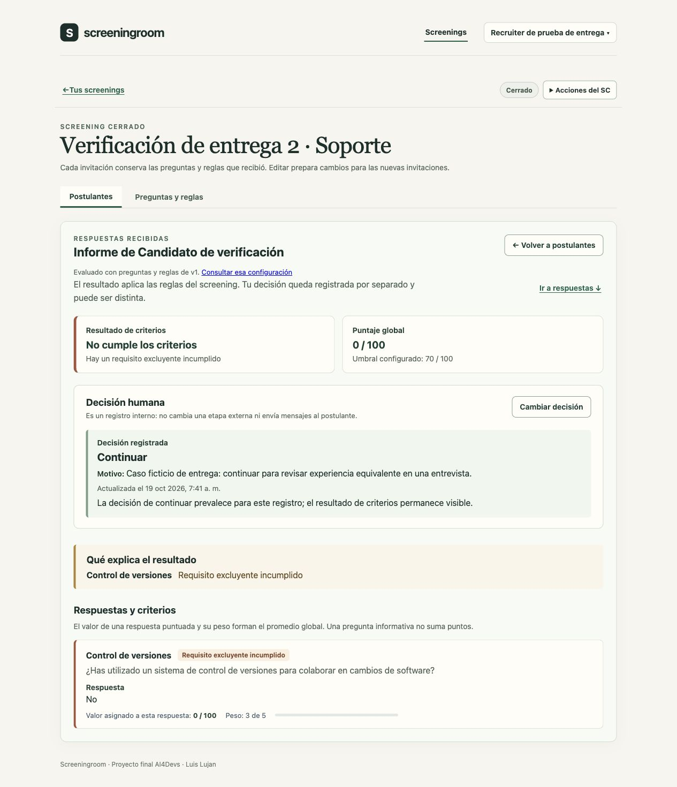
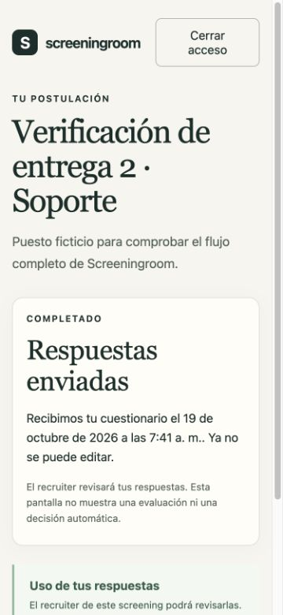

# Entrega 2 — cierre y verificación del 19/10/2026

[README](../readme.md) · [API implementada](api.md) · [Backlog](backlog.md) · [Evidencia anterior del 04/10](entrega-2-verificacion-2026-10-04.md).

## Estado de la entrega

El núcleo de entrega 2 está implementado: web React, API NestJS y MongoDB conectados; preparación/publicación del SC, invitación, acceso del candidato, guardado/reanudación/envío, informe y decisión humana. El cierre conserva resultados. Este bloque actualiza documentación y evidencia sobre el código base `9d5de05`, sin modificar la aplicación. La formalización por formulario sigue pendiente; este archivo y los PRs internos no la sustituyen.

El feedback de entrega 1 considera completas las secciones obligatorias y da luz verde al diseño. Sus recomendaciones de núcleo, contexto de agentes, buzón local y pruebas ya están implementadas. Se conservaron como pendientes la integración IA, el resto de T-09 y la preparación de la final. No se retiran controles ya implementados porque la recomendación original sugiriera posponerlos durante la construcción.

## Documentación reconciliada

- [Índice de API](api.md): 33 operaciones, actor, entradas, filtros, revisiones, resultados y errores. Se cotejó con los controladores; la especificación representativa de tres operaciones se conserva separada.
- [OpenAPI](openapi.yaml): versión de configuración distinguida del algoritmo v1; edición para nuevas invitaciones distinguida de copia; campos de candidato/versión del informe; errores Nest y `issues` reales, sin prometer `{code,fields}` o 410; confirmación booleana con enum compatible con OpenAPI 3.0.
- Guías: lista paginada sin tope total silencioso de cien; cierre/copia independiente; notas claras sobre evidencias históricas frente al estado vigente.
- README: fecha, estado de entrega y enlaces a API/evidencia; Mailpit de desarrollo identificado y proveedor IA/correo externo pendientes.
- [Registro de IA](../prompts.md): resumen por fase y modelos identificables. La selección declarada por Luis no se atribuye retrospectivamente a todos los turnos ni a los revisores. Se conservan como no registradas las identificaciones que no se pudieron comprobar.

## Pruebas ejecutadas el 19/10

| Comprobación | Resultado |
| --- | --- |
| Tipos, lint, compilación web/API y OpenSpec | Correctos |
| Persistencia | 14/14 |
| Autenticación | 13/13 |
| Screenings, banco, versiones y listas | 24/24 |
| Invitaciones/acceso candidato | 7/7 |
| Evaluación, respuestas, envío e informe | 6/6 |
| Smoke de aplicación compilada y MongoDB | Correcto |
| Índice de API frente a controladores | 33/33 operaciones coincidentes |
| YAML/referencias y esquemas de publicación/informe/errores | Correctos, contrastados con HTTP real |

Total: **64 pruebas automatizadas**, además de smoke y comprobaciones documentales. El runtime local disponible fue Node 24.19.0/npm 10.8.2; no se presenta como instalación limpia con las versiones declaradas. El proyecto fija Node 24.21.0 y npm 11, y CI instala el runtime de `.nvmrc` y ejecuta `npm ci` para comprobar esa ruta reproducible. Las suites usan bases aleatorias separadas, limpian solo sus fixtures y entregan mensajes a Mailpit local. La comprobación de esquemas usó YAML y Ajv disponibles en el proyecto, adaptando nullable a JSON Schema; no se presenta como validación externa completa de OpenAPI.

## Recorrido manual realizado

Se preparó una nueva base ficticia separada de la demo de Luis y se sirvió el build en un puerto temporal. Se creó un recruiter de prueba y se cargaron las quince preguntas del banco aprobado sin alterar las bases previas.

1. Entrar, crear SC con título/área/descripción y agregar Control de versiones del banco. Configurar Sí=100, No=0, peso 3, respuesta requerida y requisito excluyente Sí; umbral 70.
2. Recargar: título, pregunta, valores, peso y requisito persisten. Revisar y publicar con confirmación explícita.
3. Invitar a un candidato ficticio y confirmar recepción del correo en Mailpit. El primer enlace del correo abre sin código adicional y retira el token de acceso de la URL.
4. Responder No, guardar, recargar, cerrar acceso y retomar con un código nuevo del buzón local: se recupera la respuesta guardada. La sesión recruiter continúa vigente.
5. Revisar, confirmar y enviar mediante Enter. Recargar: recibo persistido sin reglas internas ni edición.
6. Consultar informe: puntaje 0, umbral 70, requisito incumplido. Registrar Continuar con motivo; volver a la lista y recargar: resultado y decisión separados, cola por revisar en cero.
7. Cerrar el SC con confirmación y recargar. No se ofrece invitar; se puede reabrir el informe con su decisión en lectura.
8. Recibo del candidato a 375 × 812 px: viewport 375, clientWidth/scrollWidth 360/360 (barra vertical aparte), sin desplazamiento horizontal. Informe de recruiter revisado en escritorio. Se guardaron capturas inspeccionadas.

Este recorrido es manual en navegador integrado; no se lo contabiliza como E2E automatizado de CI. La evidencia previa del 04/10 y las suites actuales cubren además versiones, conflictos, listas de 101 registros y continuidad de invitaciones tras el cierre.

## Pendientes declarados para la final

- T-04: sugerencias de preguntas con proveedor IA, validación, revisión explícita y recuperación. Banco/manual ya permiten el flujo principal; la IA no evaluará candidatos.
- T-09: aviso con responsable/contacto, borrado anticipado y limpieza relacionada, comprobación operativa antes de datos reales. TTL de invitaciones y restricciones de vigencia ya existen.
- T-10: E2E de navegador automatizado, despliegue/HTTPS, transporte de correo externo y evidencia reproducible final.
- Decisión de producto pendiente: ampliar la duración de sesión candidata (se conservan dos horas). No bloquea el flujo de reanudación verificado.

## Publicación y formulario

Destino autorizado: fork `luislujan32/AI4Devs-finalproject`, rama `feature/entrega-2-LL`. Entrega 1 y repositorio original de la academia se conservan sin modificaciones.

[Rama de entrega 2](https://github.com/luislujan32/AI4Devs-finalproject/tree/feature/entrega-2-LL). Si el formulario solicita una URL de rama, usarla; si solicita un PR académico, confirmar ese requisito con Luis. El PR interno de cierre tiene como base entrega 2 del fork. La publicación del código no activa por sí sola el formulario de entrega.

Los enlaces de PR/CI se añaden con resultados reales al completar la publicación; no se atribuye al resultado local una ejecución remota.
