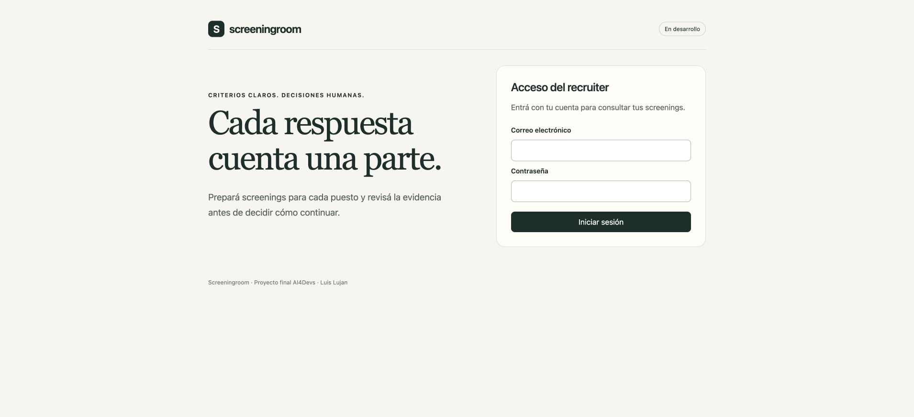
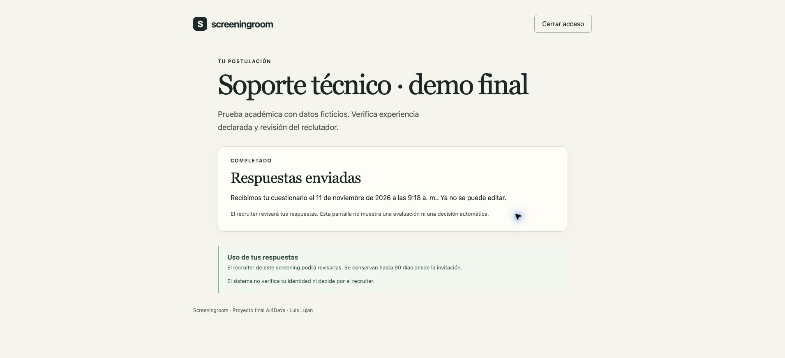
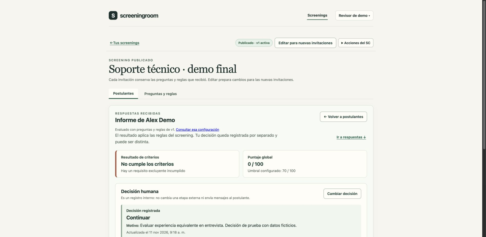
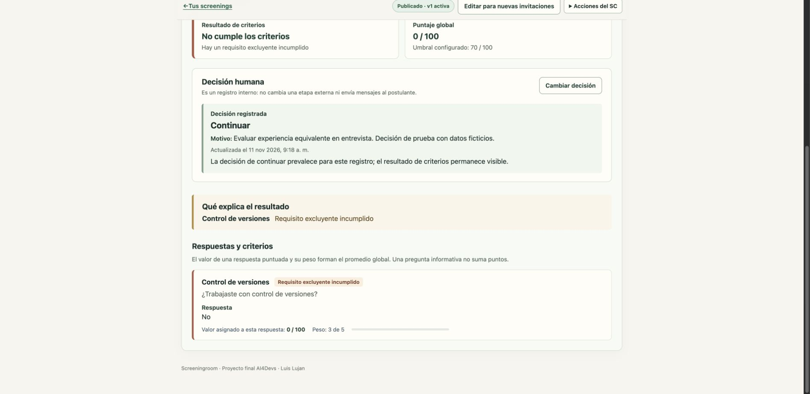
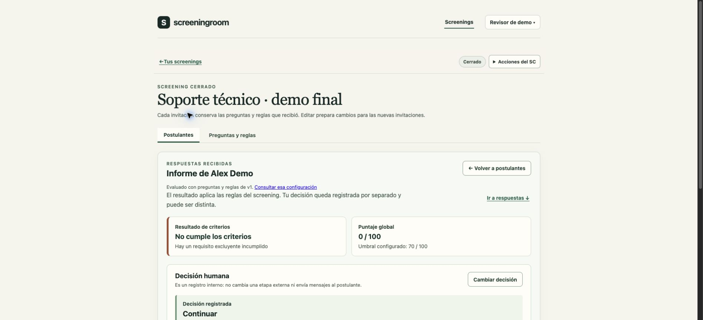

# Entrega final — verificación del 11/11/2026

## Estado

[Demo pública](https://screeningroom-ll-demo.onrender.com) · [buzón de pruebas](https://screeningroom-ll-demo.onrender.com/buzon/) · [instrucciones para el revisor](demo-publica.md#cómo-probar-como-revisor).

El código funcional, las pruebas y el despliegue están preparados. El recorrido público de los dos roles está verificado, incluido el cierre con resultados conservados tras recargar; se guardaron capturas del recibo, del informe y del estado cerrado. Faltan compartir las dos contraseñas de revisión y consolidar la rama de entrega. Este documento distingue la evidencia local y de CI de lo observado en la infraestructura pública.

## Pruebas automatizadas

- 71 pruebas unitarias/de integración: persistencia 14, acceso 13, screenings 24, invitaciones 7, intento/evaluación 6 y correo 7.
- Smoke de la API y comprobaciones de tipos, lint, compilación y OpenSpec.
- Dos E2E en Chromium, con configuración Mailpit y Brevo: creación/publicación, invitación, acceso por correo, guardado, salida y reanudación por código, envío, informe, decisión divergente con motivo y cierre con informe disponible. Usan bases aisladas y direcciones ficticias, sin enviar correo externo.
- [GitHub Actions del commit desplegado `a77466a`](https://github.com/luislujan32/AI4Devs-finalproject/actions/runs/43016005051): completado correctamente, incluyendo E2E. Se fijó Ubuntu 22.04 para mantener compatibilidad del contenedor MongoDB utilizado en CI.
- [GitHub Actions de la integración Brevo `bc84159`](https://github.com/luislujan32/AI4Devs-finalproject/actions/runs/43029389809): completado correctamente con las 71 pruebas, smoke y ambos E2E. El despliegue `d1c7e0a` incorpora esa implementación y documentación posterior.

## Despliegue público observado

- Render: servicio Docker **screeningroom-ll-demo**, plan **Free**, Virginia. Rama `feature/entrega-final-demo-LL`, commit `a77466a`; despliegue manual exitoso. Despliegue automático desactivado.
- Atlas: proyecto independiente **Screeningroom Demo**, clúster **screeningroom-demo**, tier **Free**, base `screeningroom_demo_public`. Usuario de aplicación limitado a `readWrite` en esa base.
- Acceso de red: `74.220.49.0/24` y `74.220.57.0/24`, mostrados por Render y autorizados expresamente por Luis. Ambas reglas quedaron activas; son rangos compartidos de Render, con autenticación de base obligatoria.
- La aplicación mostró el formulario de acceso en su URL HTTPS. `/api/health/ready` devolvió `status: ready` y `database: connected`.
- Luis creó el usuario de base e introdujo los secretos directamente en los paneles. No se incorporan a código, capturas públicas ni este documento.
- Se actualizó después a `d1c7e0a` con Brevo configurado por Luis. Se verificó recepción real de invitación y códigos en el destinatario autorizado, reanudación, envío y un informe de 100/100. [Registro y capturas del correo real](correo-brevo.md#prueba-real-del-11112026).

El primer despliegue falló antes de configurar el acceso de red. Después de activar ambos rangos se desplegó el mismo commit correctamente. La pantalla de espera de Render no se consideró evidencia de que la aplicación estuviera lista.

## Recorrido público autenticado

Luis confirmó el acceso a la app y al buzón con las credenciales guardadas. Se realizó esta prueba manual en Brave sobre el despliegue `a77466a`:

1. Crear **Soporte técnico · demo final** en Tecnología. Configurar una pregunta Sí/No sobre control de versiones, requerida, con peso 3, valores Sí = 100 y No = 0, requisito excluyente cumplido solo por Sí y umbral 70. El borrador se guardó y se publicó v1.
2. Invitar a **Alex Demo**, `alex-final-1111@example.test`. El correo llegó al buzón autenticado y su enlace abrió el cuestionario sin pedir código; el token de un uso desapareció de la URL.
3. Responder **No**, guardar y cerrar acceso. Pedir un código, leerlo en el buzón y retomar la misma respuesta guardada.
4. Revisar las respuestas. El envío estaba deshabilitado antes de confirmar la revisión; al confirmar y enviar apareció el recibo, conservado tras recargar, sin acciones de edición.
5. Recargar Postulantes: una respuesta recibida y una por revisar. Abrir el informe: **0/100**, umbral 70 y requisito excluyente incumplido, con la evidencia de la respuesta.
6. Elegir **Continuar**. El formulario rechazó el motivo vacío. Registrar un motivo ficticio de experiencia equivalente y volver a la lista: decisión **Continuar**, criterios **No cumple**, cero por revisar. Reabrir el informe conservó decisión y motivo sin modificar el cálculo.
7. Con autorización expresa de Luis, cerrar **Soporte técnico · demo final**. Recargar: estado **Cerrado**, informe 0/100, decisión **Continuar** y motivo conservados. Volver a Postulantes: no se ofrece invitar, se explica el cierre y el informe puede abrirse nuevamente.

Al retomar esta última comprobación, Render presentó su pantalla de arranque en frío. Tras despertar y recargar, la aplicación conservó la sesión del recruiter, el screening, las respuestas y la decisión. La primera solicitud de cierre no se había aplicado durante el arranque; se comprobó que seguía publicado antes de repetirla. Solo se dio por cerrado después de recibir la confirmación y verificarlo tras recargar.

## Pendientes para cerrar la entrega

- Compartir con el revisor las dos contraseñas guardadas por Luis y consolidar la rama `finalproject-LL` tras verificarla.

## Límites conocidos

Se admiten correos personales autorizados para revisión mediante Brevo y `@example.test` mediante Mailpit; nombres y respuestas deben ser ficticios. El buzón de pruebas es compartido entre revisores y efímero; Atlas conserva los datos de producto. La instancia gratuita puede dormir y necesitar un arranque en frío. La prueba local del contenedor usó 0,5 CPU y 512 MiB; Render Free ofrece 0,1 CPU y 512 MiB, por lo que no se atribuye equivalencia de rendimiento.

La generación de preguntas mediante IA (T-04), el borrado anticipado y la operación completa de privacidad (T-09) siguen pendientes. La creación manual y el banco están disponibles; la evaluación es determinista. El correo externo sirve para revisión académica voluntaria; el uso con postulantes reales queda fuera de esta demo.
