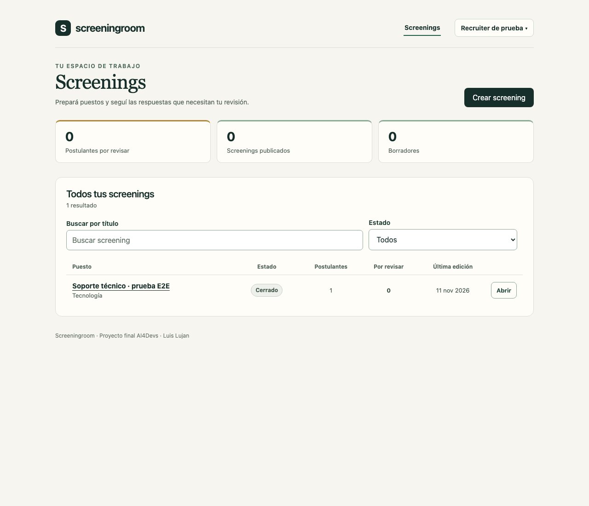
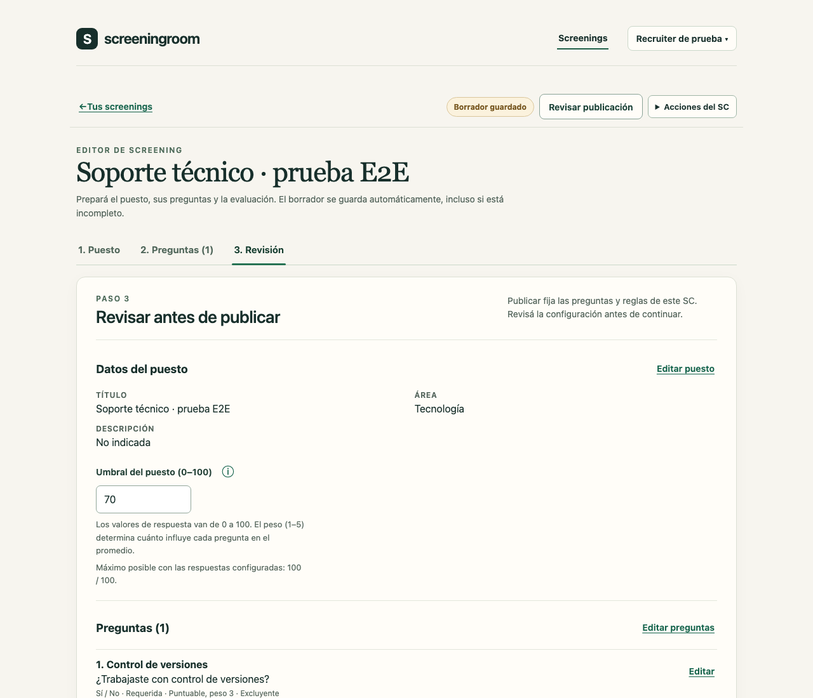
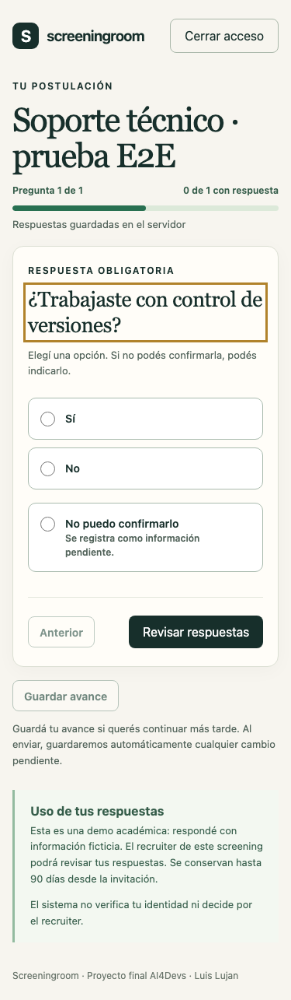
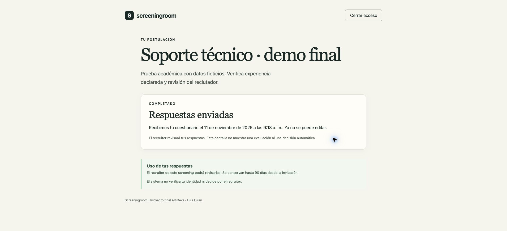
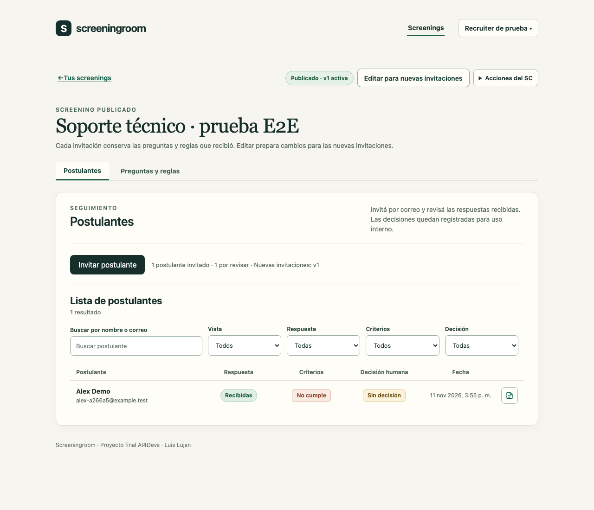
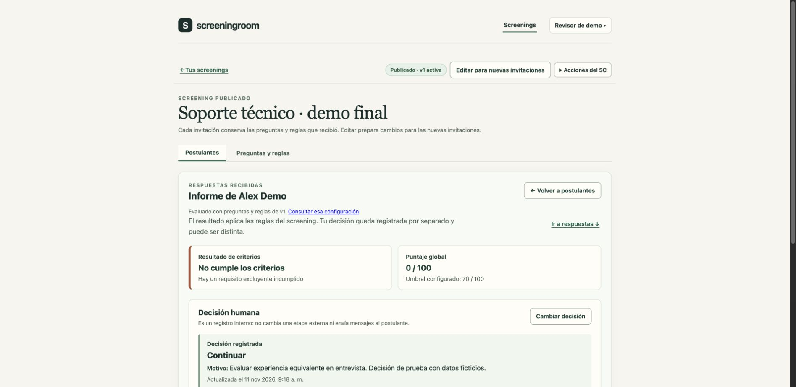
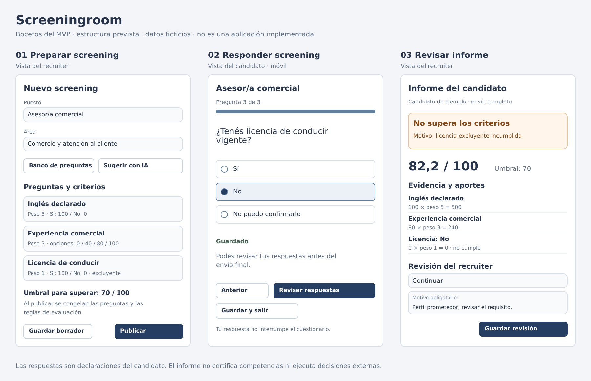
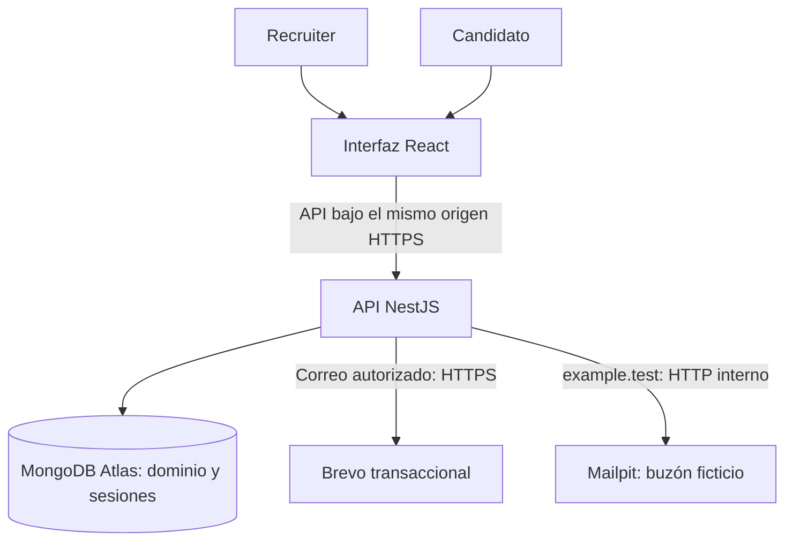
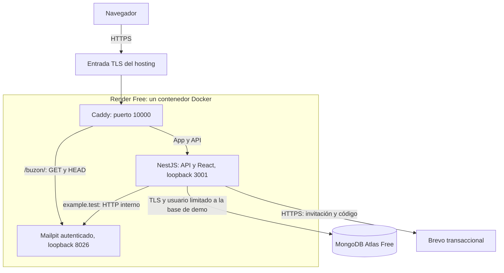
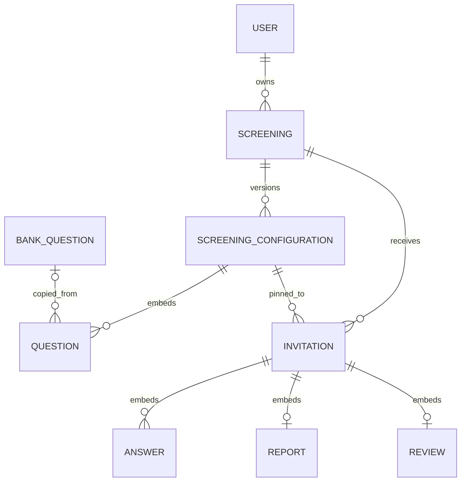

# Screeningroom — Proyecto final AI4Devs

**Luis Lujan (LL) · Entrega final preparada, pendiente de envío · Actualización: 11 de noviembre de 2026.**

[Abrir la demo](https://screeningroom-ll-demo.onrender.com) · **[Guía rápida del revisor](docs/revision-final.md)** · [Pruebas y evidencia](docs/entrega-final-verificacion-2026-11-11.md) · [Registro de IA](prompts.md).

El flujo principal funciona de principio a fin: configurar/publicar → invitar por correo → responder/guardar/retomar/enviar → informe → decisión del recruiter → cierre con resultados conservados. La demo usa Render Free, MongoDB Atlas Free y correo Brevo, verificado con recepción real. Las direcciones ficticias `example.test` usan Mailpit. Hay **71 pruebas unitarias/de integración y dos E2E en Chromium**.

**Alcance final confirmado por Luis el 11/11:** se entregan las cuatro capacidades operativas; las sugerencias de preguntas con IA (T-04) se aplazan explícitamente y permanecen en el backlog. T-09 sigue parcial: borrado anticipado y gestión operativa de privacidad. Esta es una demo académica con nombres y respuestas ficticios. **Pendientes del envío:** Luis facilitará la contraseña de prueba por el canal privado de la entrega y enviará Typeform con la rama `final-project-LL`.

[Instalación local](docs/desarrollo.md#preparar-y-ejecutar) · [Índice de las 33 operaciones de API](docs/api.md) · [Harness y aprendizajes del máster](docs/harness.md). Las entregas anteriores y sus resultados se conservan como [historial de entrega 2](docs/entrega-2-cierre-2026-10-19.md).

## Índice

0. [Ficha del proyecto](#0-ficha-del-proyecto)
1. [Descripción general del producto](#1-descripción-general-del-producto)
2. [Arquitectura del sistema](#2-arquitectura-del-sistema)
3. [Modelo de datos](#3-modelo-de-datos)
4. [Especificación de la API](#4-especificación-de-la-api)
5. [Historias de usuario](#5-historias-de-usuario)
6. [Tickets de trabajo](#6-tickets-de-trabajo)
7. [Pull requests](#7-pull-requests)

**Anexos:** [Reglas del producto](docs/producto.md) · [Backlog](docs/backlog.md) · [OpenAPI](docs/openapi.yaml) · [Registro de IA](prompts.md).

## 0. Ficha del proyecto

### 0.1. Autor

Luis Lujan. Proyecto individual con asistencia de ChatGPT y Codex.

### 0.2. Nombre

**Screeningroom.**

### 0.3. Descripción breve

Aplicación web de screening de candidatos. El recruiter prepara preguntas y criterios del puesto, asigna pesos y requisitos excluyentes y envía una invitación individual. El candidato responde, revisa y retoma su avance sin crear una cuenta. El sistema genera un informe con puntuación, evidencia y faltantes; el recruiter registra su decisión por separado. El banco por áreas y las preguntas propias permiten preparar los cuestionarios. Las sugerencias de IA previstas en T-04 todavía no están disponibles.

### 0.4. URL de la aplicación

[Abrir Screeningroom](https://screeningroom-ll-demo.onrender.com) · [Buzón de pruebas](https://screeningroom-ll-demo.onrender.com/buzon/).

Acceso a la aplicación: **`revisor@example.test`**. Luis confirmó que facilitará la contraseña de demo al revisor por el canal privado de la entrega; no se publica en este repositorio. El revisor puede invitar a su propio correo y completar el cuestionario con nombre y respuestas ficticios; para este recorrido no necesita acceder a Mailpit. El buzón opcional para `example.test` usa **`revisor`** y otra contraseña privada. [Pasos y resultados esperados](docs/revision-final.md). Render Free puede tardar alrededor de un minuto en despertar tras un período sin visitas.

### 0.5. Repositorio

[Rama de la entrega final: **`final-project-LL`**](https://github.com/luislujan32/AI4Devs-finalproject/tree/final-project-LL) en el [fork público propio](https://github.com/luislujan32/AI4Devs-finalproject). Contiene código, README, registro de IA y evidencia del estado preparado para revisión. La preparación se conserva en `feature/entrega-final-demo-LL` y la integración en `feature/entrega-2-LL`. `finalproject-LL` es el alias anterior de entrega 2 y se conserva. La entrega 1 está en `feature/entrega-1-LL` y su [PR académico #340](https://github.com/LIDR-academy/AI4Devs-finalproject/pull/340).

Según las pautas finales, la entrega formal se realiza enviando el enlace directo de la rama mediante [Typeform](https://lidr.typeform.com/proyectoai4devs), con el correo del calendario de formación. No requiere un PR al repositorio del máster. El fork es público; si pasa a privado, debe concederse lectura a `LIDR-AI4Devs`.

## 1. Descripción general del producto

### 1.1. Objetivo

Screeningroom permite preparar un screening acorde al puesto y comprender sus resultados para decidir cómo continuar con una candidatura.

- **Recruiter:** configura los criterios y consulta un informe que muestra el origen de cada conclusión, sin ocultar información favorable detrás de un resultado general.
- **Candidato:** completa un recorrido breve, puede revisar y retomar sus respuestas y llega al final aunque no cumpla un requisito excluyente.

El producto admite distintos tipos de puestos. Las preguntas propias permiten trabajar en áreas que todavía no estén cubiertas por el banco inicial.

### 1.2. Características y funcionalidades principales

**Estado de las cinco capacidades planteadas en la entrega 1:**

| Capacidad | Estado verificado |
| --- | --- |
| Preparar y publicar screenings con preguntas propias o del banco, pesos, excluyentes y umbral | Implementada |
| Obtener propuestas de preguntas mediante IA y revisarlas antes de incorporarlas | T-04 aplazado para después de esta entrega, por decisión explícita de Luis el 11/11 |
| Invitar, validar acceso por correo y responder, guardar, retomar y enviar | Implementada |
| Consultar un informe por criterio, con evidencia y cálculo determinista | Implementada |
| Registrar la decisión del recruiter, incluso distinta del resultado calculado | Implementada |

Cuatro capacidades están operativas. Luis aprobó aplazar T-04 para cerrar esta entrega con el flujo estable; HU-02, P-07 y sus criterios se conservan como trabajo pendiente. Esta desviación respecto de la entrega 1 queda registrada en el [backlog](docs/backlog.md#decisión-de-alcance-final--11112026).

Autenticación, control de acceso y conservación de datos sostienen estas capacidades; no son productos separados.

**Deseables posteriores al flujo principal:** exportación del informe y demostración de su consumo mediante un cliente externo genérico. No se promete una integración con un sistema concreto ni webhooks en el primer MVP.

**Evolución posterior:** WhatsApp, audio, interpretación de CV, certificación de competencias, assessments, entrevistas adaptativas, colaboración entre recruiters y subáreas del banco. Luis propuso además estudiar otras plataformas, permitir guardar preguntas propias reutilizables y explorar preguntas generales. [Ideas por definir](docs/backlog.md#ideas-posteriores-propuestas-por-luis-28092026). No forman parte del compromiso inicial.

Las reglas de evaluación, publicación, banco y revisión humana se especifican en el [contrato funcional P-01 a P-08](docs/producto.md).

### 1.3. Diseño y experiencia de usuario

1. El recruiter inicia sesión con correo y contraseña. En el MVP las cuentas se aprovisionan mediante un comando administrativo; no se desarrolla registro público, roles complejos ni recuperación de contraseña por interfaz.
2. Crea el screening, elige área y agrega preguntas propias o del banco. Confirma puntuación, pesos, excluyentes, obligatoriedad y umbral. Las sugerencias por IA siguen pendientes de T-04.
3. Publica una configuración válida. Cada versión publicada queda inmutable. Editar el mismo SC prepara una nueva versión para futuras invitaciones; las ya emitidas conservan sus preguntas y reglas. Puede cerrar el SC para detener nuevas invitaciones o crear otro SC independiente basado en la configuración activa.
4. Registra el correo del candidato y obtiene un enlace individual para compartir. El nombre es opcional. Una invitación contiene un único intento; no hay importación masiva ni reintentos de evaluación en el MVP.
5. Al abrir el enlace del correo por primera vez, el candidato accede mediante un token de un uso. El enlace que copia el recruiter requiere un código enviado al correo registrado. El identificador público por sí solo no permite leer el cuestionario ni respuestas. El código comprueba acceso al buzón, no identidad civil ni titularidad exclusiva.
6. El candidato lee el aviso de uso de datos, responde y guarda su avance. Puede salir y retomar mediante un nuevo acceso autorizado.
7. Revisa las respuestas y realiza el envío final. Una respuesta desfavorable nunca interrumpe el recorrido. Tras el envío no puede modificar respuestas; ve confirmación, no el informe interno.
8. El sistema conserva el envío y genera el informe. El recruiter lo revisa y registra continuar o no continuar; al continuar pese a un resultado negativo o pendiente debe explicar el motivo. La decisión se ve en lista e informe sin alterar el cálculo ni enviar mensajes. Los antiguos registros de aclaración se conservan legibles, pero no se admiten nuevas aclaraciones sin un flujo real de comunicación.

**Parámetros iniciales de acceso:** invitación vigente durante 7 días; código aleatorio de 6 dígitos, de un solo uso, válido 10 minutos; máximo 5 verificaciones fallidas por desafío, reenvío a partir de 60 segundos y máximo 5 envíos por invitación por hora, además de límite por IP. Reenviar invalida el código anterior, sin reiniciar el límite horario. Son decisiones configurables del producto.

Las sesiones del recruiter duran como máximo 8 horas; las del candidato, 2 horas y nunca más que la vigencia de su invitación. El servidor comprueba estas condiciones en cada operación. Revalidar el acceso recupera el mismo intento. Vencer una invitación no elimina inmediatamente el informe del recruiter.

**Producto implementado:** las capturas locales del 11/11 muestran el listado, editor, postulantes y cuestionario móvil con datos ficticios y una base aislada. El recibo y el informe siguientes se obtuvieron en la demo pública. El [registro de evidencia](docs/entrega-final-verificacion-2026-11-11.md) distingue ambos entornos; [la recepción de correo real](docs/correo-brevo.md#prueba-real-del-11112026) se verificó por separado.

Espacio recruiter: estados, conteos, búsqueda y filtros

Configuración y revisión antes de publicar

Postulante: cuestionario móvil y confirmación de envío

Seguimiento: lista de postulantes, informe y decisión

**Diseño inicial, entrega 1:** los siguientes wireframes son bocetos históricos de estructura.

| Pantalla | Contenido y acciones |
| --- | --- |
| Acceso del recruiter | Correo, contraseña, iniciar sesión, errores sin revelar si una cuenta existe |
| Listado | Screenings propios, estados borrador/publicado/cerrado, conteos, búsqueda, filtros y paginación |
| Editor | Puesto, área, descripción, preguntas, reglas, banco, revisión previa y publicar; sugerencias IA pendientes |
| Postulantes | Invitación por correo, nombre opcional, recepción, criterios y decisión en columnas independientes, filtros, paginación e informe; borrado individual pendiente de T-09 |
| Acceso del candidato | Solicitar código, verificarlo y avisos de vencimiento/reenvío |
| Cuestionario | Una pregunta por paso, anterior/siguiente, progreso, guardar y salir, resumen editable antes de enviar |
| Informe | Resultado, puntuación o cálculo pendiente, evidencia, excluyentes, faltantes y revisión humana |

Los formularios incluyen etiquetas, navegación por teclado, foco visible y estados descritos mediante texto. El E2E del candidato usa 375 × 812 px y comprueba que no haya desbordamiento horizontal; las comprobaciones manuales adicionales están fechadas en la evidencia. Esto no equivale a una auditoría completa de accesibilidad ni a validación con recruiters representativos, que sigue pendiente. Solo se muestra «Guardado» cuando el servidor confirmó la persistencia. No se conserva información del candidato en `localStorage`.

### 1.4. Instrucciones de instalación

La base del proyecto se ejecuta con Node.js 24.21.0, npm 11 y Docker/Compose. [Instalación, variables, comandos y alcance actual](docs/desarrollo.md). MongoDB y Mailpit se preparan como servicios locales; la interfaz consulta disponibilidad real mediante NestJS. El comando de demo aprovisiona cuentas y screenings ficticios; el banco inicial revisado tiene quince preguntas. No se cargan datos reales.

Los documentos pueden leerse directamente en GitHub; los diagramas usan Mermaid y las tres operaciones de producto representativas están descritas en OpenAPI 3.0.3 y el [índice de API](docs/api.md) reúne las rutas adicionales implementadas. La comprobación de disponibilidad es infraestructura y se documenta aparte.

## 2. Arquitectura del sistema

### 2.1. Diagrama de arquitectura

**Patrón:** monolito modular con frontend separado en el código y un único servicio de despliegue. Centraliza autenticación y evaluación, reduce infraestructura y facilita las pruebas del flujo. Como contrapartida, los módulos comparten ciclo de despliegue y no escalan independientemente.

Un backend modular y una interfaz web. En despliegue, NestJS sirve la API y los archivos compilados del frontend bajo el mismo origen. MongoDB almacena dominio y sesiones. El correo entrega invitaciones y códigos; la integración del proveedor de IA para proponer preguntas sigue pendiente.

La generación de preguntas mediante IA no forma parte de este diagrama implementado: T-04 sigue pendiente. La evaluación de respuestas es local y determinista.

**Consistencia de reglas y respuestas:**

Cada configuración publicada es inmutable; el SC mantiene una activa y como máximo un borrador de cambios. Una invitación fija su configuración al crearse y conserva esa versión al responder y evaluarse. Sus preguntas tienen identificadores estables y las respuestas los referencian. El intento guarda respuestas, informe y revisión en un documento de invitación. [Contrato de versiones y compatibilidad legacy](docs/screening-versions.md).

Cada guardado compara `answerRevision`; una edición concurrente devuelve conflicto y obliga a recargar antes de sobrescribir. El envío final lee esa revisión, valida las respuestas, calcula el informe y guarda estado, fecha e informe en una única actualización condicionada por revisión, estado y vigencia. Dos envíos simultáneos no crean dos informes. Reintentar un envío ya completado devuelve la misma confirmación sin recalcular.

Esta elección aprovecha la atomicidad de escritura de un documento de MongoDB; no presupone atomicidad entre colecciones. La publicación usa el mismo control sobre la revisión del borrador. [Referencia de MongoDB](https://www.mongodb.com/docs/manual/core/write-operations-atomicity/).

### 2.2. Descripción de componentes principales

| Componente | Responsabilidad e implementación |
| --- | --- |
| Auth | Módulo de acceso recruiter, sesiones y autorización |
| Screenings | Módulo de borradores, banco, publicación, versiones, copia y cierre |
| Candidate | Módulo de invitaciones, correo, códigos, acceso y respuestas del candidato; expone también informe/revisión al recruiter propietario |
| Evaluation | Función pura de evaluación usada al enviar; no consulta proveedores externos |
| Persistence | Schemas, índices y operaciones de MongoDB/Mongoose |
| Suggestions, previsto en T-04 | No implementado: contexto de vacante, llamada de IA y validación de propuestas |

**Stack elegido:** React + Vite + TypeScript en frontend; NestJS con Express en backend; MongoDB mediante Mongoose; monorepo con npm workspaces.

| Elección | Motivo para este producto |
| --- | --- |
| React + Vite | Interfaz de formularios y navegación sin necesidad de renderizado en servidor ni posicionamiento público |
| NestJS | Módulos, validaciones y autorización con una estructura explícita que facilita dividir tickets y pruebas |
| TypeScript | Un lenguaje para ambos lados; los datos externos se validan igualmente en tiempo de ejecución |
| MongoDB + Mongoose | Cuestionarios con preguntas embebidas e intentos autocontenidos; esquemas y restricciones explícitas |
| npm workspaces | Coordina dos aplicaciones sin sumar un orquestador de monorepo |

React documenta Vite entre las herramientas para construir una aplicación desde cero; NestJS documenta su [integración con Mongoose](https://docs.nestjs.com/techniques/mongodb). La elección conjunta es una decisión de diseño de Screeningroom, no un requisito del máster. [Referencia React](https://react.dev/learn/build-a-react-app-from-scratch), [referencia workspaces](https://docs.npmjs.com/cli/v11/using-npm/workspaces/).

PostgreSQL también sería válido. Se elige MongoDB porque la configuración y el intento se consultan y guardan como conjuntos delimitados. El coste es hacer cumplir referencias y ownership en la aplicación; no se usará la flexibilidad de documentos para omitir validaciones.

### 2.3. Estructura del proyecto

| Ruta | Estado actual | Propósito |
| --- | --- | --- |
| `readme.md` | Incluido | Ficha y documentación técnica principal |
| `prompts.md` | Incluido | Herramientas, workflows y ajustes humanos reales |
| `docs/producto.md` | Incluido | Reglas P-01 a P-08 y ejemplos de evaluación |
| `docs/backlog.md` | Incluido | Historias adicionales, tickets y dependencias |
| `docs/openapi.yaml` | Incluido | Tres operaciones representativas |
| `docs/wireframes.svg` | Incluido | Bocetos de interfaz |
| `apps/web` | Integrado en entrega 2 | Acceso del recruiter, editor, invitaciones, formulario del postulante, informe y revisión humana |
| `apps/api` | Integrado en entrega 2 | NestJS/Express, MongoDB, autenticación, screenings, invitaciones, evaluación, informes y revisión humana |
| `scripts/*.test.mjs` | Seis suites, 71 pruebas | Unitarios de cálculo/correo e integración HTTP/MongoDB/Mailpit |
| `scripts/e2e/screening.spec.mjs` | Dos E2E en Chromium | Recorrido completo con los dos roles y candidato móvil |
| `deploy`, `Dockerfile` | Desplegados | Imagen única, Caddy, aprovisionamiento de demo y buzón ficticio |
| `.github/workflows/check.yml` | Configurado y ejecutado; [evidencia final](docs/entrega-final-verificacion-2026-11-11.md) | Tipos, lint, build, OpenSpec, seis suites, smoke y ambos E2E |

El monorepo contiene frontend y backend como npm workspaces. Cada regla se mantiene en su documento de referencia. [Comandos y workflow OpenSpec](docs/desarrollo.md).

### 2.4. Infraestructura y despliegue

**Demo desplegada y verificada el 11/11/2026.** Render Free termina HTTPS y envía tráfico a Caddy en el contenedor. Caddy deriva la app/API a NestJS y `/buzon/` a Mailpit autenticado, con acceso web de lectura. NestJS sirve React compilado y la API; MongoDB Atlas Free conserva dominio y sesiones en una base exclusiva. Brevo entrega invitaciones/códigos al correo autorizado del revisor. [Configuración y verificación](docs/demo-publica.md).

**Proceso implementado:**

1. Instalar las dependencias bloqueadas, comprobar tipos/lint y ejecutar las pruebas disponibles en CI.
2. Compilar React y NestJS; empaquetar el backend junto con los archivos estáticos del frontend como una única versión desplegable.
3. Configurar en Render la conexión MongoDB, el secreto de sesión, las dos contraseñas de demo y Brevo (`MAIL_PROVIDER`, `BREVO_API_KEY`, `MAIL_FROM_EMAIL`). El origen se obtiene de Render o de `PUBLIC_ORIGIN`. [.env.example](.env.example) contiene nombres y ejemplos sin secretos; [la guía](docs/demo-publica.md#configurar-el-despliegue) distingue los entornos.
4. El arranque ejecuta `deploy/seed-demo.mjs`, valida la base exclusiva de demo y los secretos, prepara índices y aprovisiona `revisor@example.test` y el banco revisado. Reiniciar no borra los screenings ni reemplaza una contraseña existente.
5. Publicar detrás de HTTPS, restringir Atlas a los rangos de salida autorizados de Render y verificar `/api/health/ready`, login y correo. Los despliegues son manuales; el despliegue automático está desactivado.
6. Ejecutar el flujo completo con un screening ficticio. Tras publicar configuraciones versionadas, un binario previo al soporte de versiones no es compatible con las nuevas invitaciones: corregir hacia adelante o restaurar una versión compatible, siguiendo [los límites de compatibilidad](docs/screening-versions.md). No realizar un rollback de datos improvisado.

Para desarrollo se usan MongoDB y Mailpit locales; invitaciones/códigos ficticios se capturan por su API HTTP. El enlace del correo permite un acceso de un uso; el enlace compartible requiere código. No existe aún un proveedor de sugerencias IA conectado; banco, autoría manual y evaluación funcionan sin él.

Mailpit captura invitaciones y códigos ficticios en desarrollo y en el [buzón autenticado de la demo pública](docs/demo-publica.md). [Brevo](docs/correo-brevo.md) envía al correo personal del revisor, con recepción, códigos y recorrido público verificados el 11/11. La selección de proveedor/modelo de IA de T-04 sigue pendiente.

### 2.5. Seguridad

Controles implementados de acceso, sesiones, CSRF, validación, conservación y límites. HTTPS y correo Brevo se verificaron en la demo pública; no se afirma operación de producción. T-09 sigue parcial y debe completar contacto/responsable y borrado operativo antes de un uso con postulantes reales. La integración de IA sigue pendiente:

- **Autorización:** cada recruiter accede solo a sus screenings e invitaciones. Cada sesión de candidato accede a una invitación concreta; no acepta un identificador arbitrario para cambiar de candidato. Objetos ajenos se responden como no encontrados.
- **Sesiones:** cookies `HttpOnly`, `Secure` en HTTPS y `SameSite=Lax`; identificador renovado al autenticar. Sesiones persistidas en MongoDB, cierre de sesión y expiración comprobada por servidor. Las mutaciones requieren token CSRF y validación de origen. NestJS advierte que el almacén en memoria por defecto no es adecuado para producción. [Referencia](https://docs.nestjs.com/techniques/session).
- **Credenciales:** contraseñas con Argon2id; códigos generados criptográficamente, almacenados como HMAC con clave del servidor y vinculados al desafío/invitación; secretos fuera del repositorio. Los límites contra fuerza bruta se guardan por invitación y se complementan por IP. Consumo y verificación del código son atómicos. [Almacenamiento de contraseñas](https://cheatsheetseries.owasp.org/cheatsheets/Password_Storage_Cheat_Sheet.html), [principios para códigos y tokens](https://cheatsheetseries.owasp.org/cheatsheets/Forgot_Password_Cheat_Sheet.html).
- **Minimización:** correo, nombre opcional y respuestas pertinentes. No se piden documentos de identidad, foto, fecha de nacimiento ni datos sensibles por defecto. Banco inicial sin criterios de características personales ajenas al puesto. La revisión humana debe verificar la pertinencia de preguntas propias o sugeridas.
- **Transparencia:** el aviso del candidato explica el uso académico, el acceso del recruiter, la conservación y el proveedor de correo cuando corresponde. Configurar el responsable/contacto operativo sigue pendiente de T-09. Las respuestas se identifican como declaraciones, no como competencias certificadas.
- **Conservación:** invitaciones, respuestas, informe y revisión se eliminan a los 90 días desde la invitación en la demo. Consultas y autorización niegan acceso tras el plazo aunque la limpieza física esté pendiente. El borrado anticipado de invitaciones y limpieza de sesiones relacionadas sigue pendiente en T-09. No se incluye backup de datos personales en la demo; cualquier despliegue con backups deberá definir también su eliminación.
- **Límite previsto para T-04, aún sin implementar:** solo descripción del puesto, área y preguntas pertinentes del banco; nunca identidades, respuestas o informes. La propuesta deberá validarse y revisarse sin capacidad de publicar ni modificar candidatos. Este diseño no acredita controles de un generador que todavía no existe.
- **Operación:** HTTPS, validación de entradas y límites de tamaño; logs de errores sin respuestas, contraseñas, códigos ni cuerpos de solicitudes. Fixtures y demostración con datos ficticios.

Estas son decisiones de diseño y buenas prácticas; no una declaración de certificación legal. El plazo propuesto no se presenta como obligación normativa.

### 2.6. Tests

La suite actual usa `node:test` para cálculo puro, transporte de correo simulado e integración HTTP real sobre MongoDB/Mailpit aislados. Son **71 pruebas en seis suites**: persistencia 14, acceso 13, screenings 24, invitaciones 7, intento/evaluación 6 y correo 7. Además hay **dos E2E en Chromium**, con configuración Mailpit y Brevo; ambos usan destinatarios ficticios y no envían correo externo. La recepción real por Brevo se comprobó manualmente y se documenta aparte.

| Nivel | Evidencia actual |
| --- | --- |
| Unitario, node:test, implementado | Fórmula, precedencia, faltantes, redondeo y validación de configuración |
| Integración, node:test + HTTP + MongoDB/Mailpit, implementado | Ownership, OTP/enlace de correo, versiones, expiración, conflictos, envío único, informes y decisiones; borrado anticipado pendiente |
| Interfaz, navegador manual, disponible | Editor, persistencia, versión recibida, acceso, recuperación, revisión/envío, informe, decisión y móvil |
| E2E automatizado, implementado | Crear/publicar → invitar → correo/código → responder/retomar/enviar → informe → revisión humana → cierre |
| Calidad de sugerencias IA, pendiente de T-04 | No hay generador implementado ni resultados de evaluación de sus propuestas; los casos de calidad siguen previstos |

CI ejecuta instalación reproducible, tipos, lint, build, OpenSpec, las seis suites, smoke y el [recorrido E2E](docs/desarrollo.md#recorrido-e2e-en-navegador). [Evidencia final y CI](docs/entrega-final-verificacion-2026-11-11.md). Las 64 pruebas de los documentos del 04/10 y 19/10 corresponden al hito histórico de entrega 2.

Para reproducir: [preparar infraestructura y credenciales locales](docs/desarrollo.md#preparar-y-ejecutar), ejecutar `npm run check`, las seis suites y `npm run smoke`; después instalar Chromium y ejecutar `npm run test:e2e`, según la guía. No se impone un porcentaje de cobertura ajeno a las pautas académicas.

## 3. Modelo de datos

### 3.1. Relaciones

`QUESTION`, `ANSWER`, `REPORT` y `REVIEW` son objetos embebidos, no colecciones independientes. El origen del banco es opcional y solo informativo. La configuración inicial legacy puede seguir embebida en el SC hasta materializar su historial; el borrador de cambios es un objeto del SC. Sesiones y desafíos no aparecen en el diagrama de dominio.

### 3.2. Colecciones y atributos

Todos los documentos de dominio tienen `_id: ObjectId`, `createdAt: Date` y `updatedAt: Date`. La API representa identificadores como cadenas y fechas como ISO 8601 UTC.

| Colección | Atributos principales y restricciones |
| --- | --- |
| `users` | `email: string` normalizado, único; `passwordHash: string`; `displayName: string`; `active: boolean`. Solo recruiter; sin roles múltiples |
| `screenings` | `ownerId: ObjectId` requerido; `title: string` 1–120; `area: string`; `description: string` hasta 6000; `status: draft/published/closed`; `revision: integer >= 0`; `threshold: integer 0–100`; `questions: Question[]` máximo 20; `publishedAt: Date?`, `closedAt: Date?`. Campos incompletos permitidos en borrador; publicación exige configuración válida. Versiones: `activeConfigurationId`, `initialConfigurationId`, `configurationVersion`, `configurationIds` y `editingDraft?`; el resolver separa la configuración inicial legacy de la activa |
| `screening_configurations` | `screeningId`, `ownerId`; `versionNumber`; título, área, descripción, umbral y preguntas publicados; `publishedAt`. Documentos inmutables; solo las referencias oficiales del SC forman su historial |
| `question_bank` | `area: string`; `criterion: string`; `text: string`; `type: boolean/single_choice/text`; `options: {id,label}[]`; `guidance: string`; `active: boolean`. Sin pesos ni condiciones excluyentes heredados automáticamente |
| `invitations` | `screeningId`, `ownerId: ObjectId`; `configurationId?`, `configurationVersion?` (sin referencia resuelve v1 legacy); `publicId: string` aleatorio opaco único; `candidateEmail: string` normalizado; `candidateName: string?`; `status: invited/in_progress/submitted`; `expiresAt`, `purgeAt: Date`; `answerRevision: integer >= 0`; `answers: Answer[]`; `submittedAt: Date?`; `report: Report?`; `review: Review?`; `auth: objeto` con desafío, HMAC, expiración, fallos y límite horario; `emailAccess?` con resumen autenticado de token, vigencia y consumo |
| `sessions` | Sesión del store: identificador opaco, principal recruiter/candidato, `userId` o `invitationId`, token CSRF y expiración. No guarda contraseñas, respuestas ni códigos |

Las invitaciones incorporan además `emailDeliveryStatus: accepted/unconfirmed` para conservar el estado de aceptación del correo y recuperarlo al recargar. `accepted` no significa recepción o lectura; `unconfirmed` conserva la invitación cuando el proveedor pudo haberla aceptado sin devolver una respuesta concluyente. [Contrato de correo](docs/correo-brevo.md#comportamiento-del-producto).

| Objeto | Atributos y reglas |
| --- | --- |
| `Question` | `id: string` único en screening; `bankQuestionId: ObjectId?`; `criterion`, `text: string` hasta 120/500; `type`; `required: boolean`; `scored: boolean`; `weight: integer 1–5` solo si puntúa; `options: {id,label,score?}[]`; `guidance: string?` (orientación copiada del banco, conservada en la pregunta); `exclusion: {acceptedOptionIds: string[]}?`. Opciones de pregunta puntuable llevan `score: integer 0–100` |
| `Answer` | `questionId: string`; `kind: option/text/unknown`; `optionId: string?`; `text: string?` hasta 2000. Una sola respuesta por pregunta; la forma y la opción deben corresponder al tipo de pregunta |
| `Report` | `algorithmVersion: "v1"`; `outcome: meets/not_meets/needs_review`; `reason: knockout/score_below_threshold/incomplete/criteria_met`; `score: number?`; `threshold: number`; `incomplete: boolean`; `criteria: CriterionResult[]`; `generatedAt: Date`. Null score significa cálculo incompleto, nunca cero implícito |
| `CriterionResult` | `questionId`, criterio, pregunta y `evidence: {status: known/unknown/missing, source: candidate_declaration, answerText: string/null}`, conforme a OpenAPI; `optionScore`, `weight`, `weightedPoints` nullable; `exclusionStatus: met/not_met/unknown/not_applicable` |
| `Review` | Nuevas decisiones `continue/do_not_continue`; `clarify` solo se conserva en registros anteriores. `reason: string` hasta 2000; `reviewerId: ObjectId`; `reviewedAt: Date`; `revision: integer >= 1`. El MVP conserva la revisión vigente; no promete historial de revisiones anteriores |

**Índices:** email único en usuarios; índices de propietario/estado y orden con desempate estable para las listas paginadas; configuración por SC/propietario; publicId único; `{screeningId, candidateEmail}` único para evitar doble invitación al mismo screening; `{area, active}` en banco; TTL sobre `purgeAt` en invitaciones y sobre la expiración del store de sesiones. El servidor no depende de que el TTL se ejecute inmediatamente.

**Integridad:** el servicio comprueba propiedad y existencia de referencias, ids de preguntas/opciones sin duplicados, una respuesta por pregunta y reglas compatibles con su tipo. No hay borrado de screenings publicados en el MVP. Las copias se crean con nuevos ids; el origen del banco no sustituye el contenido copiado. La revisión usa su propia revisión de concurrencia y nunca sobrescribe el informe.

## 4. Especificación de la API

Se adjunta [OpenAPI](docs/openapi.yaml) con tres operaciones, conforme al máximo solicitado en la plantilla. No son toda la API necesaria.

| Operación | Actor | Comportamiento |
| --- | --- | --- |
| `POST /api/screenings/{screeningId}/publish` | Recruiter propietario | Valida configuración y revisión esperada; publica o devuelve errores concretos |
| `POST /api/candidate/attempt/submit` | Candidato autenticado | Envía las respuestas ya guardadas de su invitación; persiste una sola evaluación; devuelve confirmación |
| `GET /api/invitations/{invitationId}/report` | Recruiter propietario | Devuelve resultado, desglose de evidencia y revisión humana vigente |

El [índice de API implementada](docs/api.md) reúne las 33 operaciones, sesiones, entradas, filtros, revisiones y errores, con enlaces a sus guías. Incluye login/logout, autoría, banco, invitaciones y acceso del candidato. Leer/guardar/enviar respuestas, informes, revisión, cierre, edición versionada, historial y filtros/paginación ya están implementados y documentados en sus guías. Obtener sugerencias y eliminar invitaciones siguen pendientes. OpenAPI conserva las tres operaciones representativas de la entrega.

Errores comunes: `401` sesión ausente/expirada; `403` protección CSRF; `404` recurso inexistente o ajeno; `409` conflicto de estado/revisión; `422` datos inválidos; `429` límite de solicitudes. Los errores de validación pueden incluir `issues: string[]`; no se promete un formato `{code, fields}`. Las respuestas de error no incluyen datos de otras personas. Los endpoints del candidato nunca retornan scoring, opciones excluyentes ni informe interno.

## 5. Historias de usuario

Tres historias representativas. [HU-02, HU-05 y backlog completo](docs/backlog.md) conservan el alcance original y su estado de implementación, incluida HU-02 pendiente. P-01 a P-08 remiten al [contrato funcional](docs/producto.md).

### HU-01 — Preparar y publicar

**Como** recruiter, **quiero** configurar un screening con preguntas propias o del banco y reglas explícitas, **para** recoger información pertinente al puesto.

- **Dado** un área, **cuando** consulto el banco, **entonces** aparecen sus preguntas activas y puedo crear una propia si no encuentro una adecuada.
- **Dada** una pregunta copiada, **cuando** la edito, **entonces** no cambia el banco ni otro screening, y debo confirmar sus reglas para este puesto.
- **Dado** un borrador, **cuando** intento publicarlo, **entonces** se validan pesos, puntuaciones, umbral, excluyentes y obligatoriedad según P-01/P-02/P-08.
- **Dada** una configuración incompleta, **cuando** publico, **entonces** se identifican los campos inválidos y se conserva el borrador.
- **Dado** un screening publicado, **cuando** edito y publico cambios en el mismo SC, **entonces** solo las invitaciones futuras reciben la nueva configuración; las anteriores mantienen sus reglas y comparten la lista del SC. Crear otro SC basado en este sigue siendo una copia independiente.
- **Dado** un recruiter distinto del propietario, **cuando** intenta leer o modificar el screening, **entonces** no obtiene acceso.

### HU-03 — Completar y retomar

**Como** candidato, **quiero** responder desde mi invitación, revisar y retomar mi avance, **para** completar el screening sin perder las respuestas guardadas.

- **Dado** el enlace del correo, **cuando** lo abro por primera vez con token vigente, **entonces** accedo sin código adicional. **Dado** el enlace compartible o un token consumido sin sesión, **cuando** valido el código, **entonces** accedo solo a mi intento sin crear una cuenta.
- **Dado** un código usado, vencido o con intentos agotados, **cuando** lo presento, **entonces** no se crea una sesión.
- **Dadas** respuestas guardadas, **cuando** retomo con acceso válido, **entonces** recupero esas respuestas.
- **Dada** una respuesta desfavorable, **cuando** avanzo, **entonces** puedo completar el resto del cuestionario.
- **Dada** una pregunta obligatoria vacía, **cuando** envío, **entonces** se solicita completarla; una respuesta estructurada «No puedo confirmarlo» es válida pero queda pendiente de evaluación.
- **Dado** un envío confirmado, **cuando** se reintenta, **entonces** se devuelve la misma confirmación sin otro informe; no se admiten nuevas ediciones.
- **Dado** un fallo de guardado, **cuando** intento avanzar, **entonces** no se informa guardado exitoso y puedo reintentar sin perder lo que sigo viendo en pantalla.

### HU-04 — Consultar el informe

**Como** recruiter, **quiero** un informe por criterio con puntuación, evidencia y faltantes, **para** entender el resultado y decidir cómo continuar.

- **Dado** un requisito excluyente incumplido y puntaje alto, **cuando** consulto el informe, **entonces** figura «No supera los criterios» y la evidencia que lo explica.
- **Dadas** respuestas suficientes, excluyentes cumplidos y puntaje igual o superior al umbral, **cuando** se evalúan, **entonces** figura «Supera los criterios».
- **Dadas** respuestas suficientes bajo el umbral, **cuando** se evalúan, **entonces** el motivo es puntuación insuficiente.
- **Dada** información evaluable faltante sin un excluyente incumplido, **cuando** se evalúa, **entonces** figura «Pendiente de revisión» y no se asigna cero al faltante.
- **Dado** cualquier resultado, **cuando** abro el detalle, **entonces** se muestran también el resto de las respuestas y sus aportes, no solo los motivos negativos.
- **Dada** una declaración de idioma o competencia, **cuando** se presenta como evidencia, **entonces** se identifica como declaración, no como certificación.

## 6. Tickets de trabajo

Tres tickets representativos: datos, backend y frontend. [Backlog y criterio de terminado](docs/backlog.md).

### T-01 — Persistencia del dominio e invariantes (base de datos)

**Objetivo:** disponer de schemas, índices y fixtures reproducibles para cuestionarios e invitaciones consistentes.  
**Historias:** HU-01, HU-03, HU-04, HU-05. **Dependencia:** T-00.

**Trabajo:** definir los cinco schemas de la sección 3; crear índices; validar identificadores y límites; cargar usuarios y datos ficticios mediante comandos explícitos; implementar repositorios concretos solo donde separen persistencia de dominio, sin una jerarquía genérica de CRUD.

**Aceptación:** rechaza usuario duplicado y doble invitación al mismo correo/screening; valida preguntas y respuestas; referencias ajenas son rechazadas por servicios; TTL y filtros de vigencia no se confunden; fixtures se cargan de manera repetible sin borrar datos ajenos. Pruebas con MongoDB real de pruebas verifican índices y actualizaciones condicionadas.

### T-07 — Envío y evaluación atómicos (backend)

**Objetivo:** producir una sola evaluación reproducible por intento.  
**Historias:** HU-03, HU-04. **Dependencias:** T-01, T-03 y T-05.

**Trabajo:** lectura y guardado de respuestas con `answerRevision`; función pura de evaluación P-01 a P-08; implementación del envío final; comparación de revisión; persistencia conjunta de estado e informe; confirmación idempotente.

**Aceptación:** cumple todos los [ejemplos del contrato funcional](docs/producto.md#ejemplos-de-aceptación-del-cálculo); no divide por cero; no trata desconocido como cero; no redondea antes de comparar; concurrencia o reintentos no duplican informe; screening congelado y respuestas enviadas determinan el resultado sin IA. Pruebas unitarias de reglas e integración de envío/guardado concurrente.

### T-06 — Recorrido del candidato y borrador persistente (frontend)

**Objetivo:** completar y retomar un cuestionario desde móvil con confirmación real de guardado.  
**Historia:** HU-03. **Dependencias:** T-03, T-05 y T-07 para integración; desarrollo de interfaz contra el contrato acordado.

**Trabajo:** formulario por pasos; consumo de los endpoints de lectura, guardado y envío definidos en T-07; estados de carga/error; revisión final; pantalla de confirmación; navegación por teclado. La interfaz puede desarrollarse contra respuestas simuladas del contrato y conectarse a T-07 para su aceptación integrada.

**Aceptación:** retoma respuestas persistidas, no corta por excluyentes, distingue vacío/desconocido, permite revisar antes de enviar, comunica conflictos y fallo de guardado, impide editar después del envío. Pruebas de componentes y E2E del flujo cuando T-07 esté integrado.

## 7. Pull requests

La entrega 1 se presentó mediante `feature/entrega-1-LL` y el [PR académico #340](https://github.com/LIDR-academy/AI4Devs-finalproject/pull/340). La implementación avanza en `feature/entrega-2-LL`. [PR de integración #2 del fork](https://github.com/luislujan32/AI4Devs-finalproject/pull/2): flujo principal, espacio recruiter, versiones para futuras invitaciones y documentación consolidada. [Validación y pendientes](docs/entrega-2-verificacion-2026-10-04.md).

[PR de cierre #3](https://github.com/luislujan32/AI4Devs-finalproject/pull/3): documentación/API reconciliadas y nueva verificación del 19/10. [Evidencia actual y pendientes de la final](docs/entrega-2-cierre-2026-10-19.md).

[PR interno de preparación final #5](https://github.com/luislujan32/AI4Devs-finalproject/pull/5): dos E2E, imagen Docker, demo gratuita y correo Brevo; base `feature/entrega-2-LL`. Se encontraba en borrador, abierto y sin fusionar al contrastar las pautas el 11/11. El PR organiza el desarrollo del fork; la entrega académica se formaliza con la rama final y Typeform.
